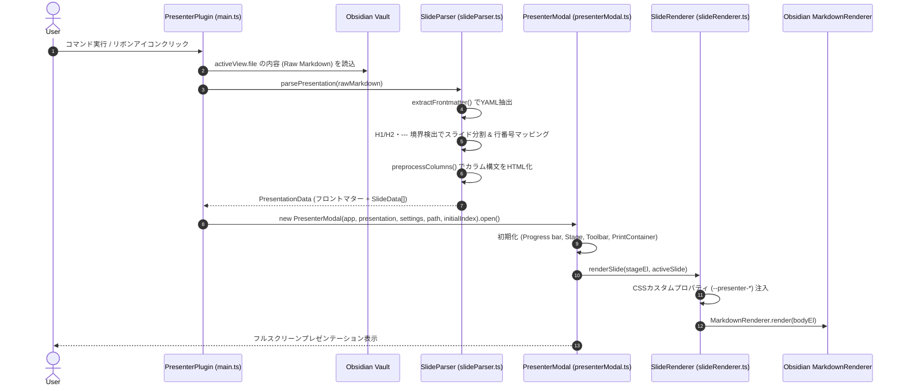
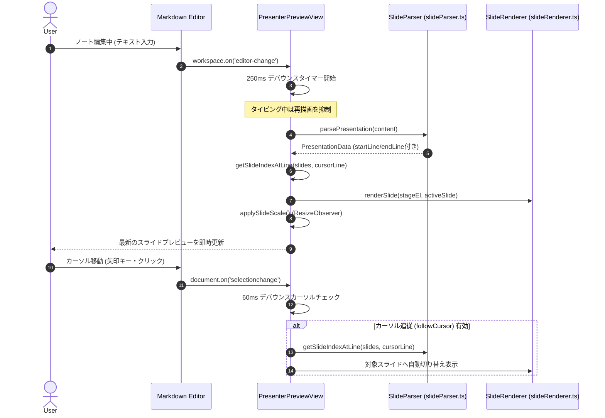
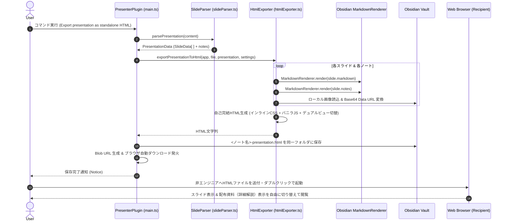
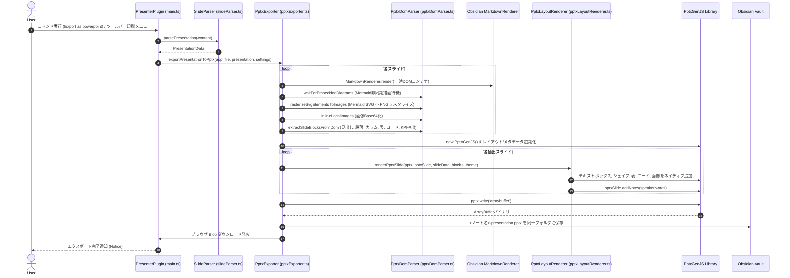

# システムアーキテクチャ設計書 (System Architecture Document)

## 1. 概要 (Overview)

本ドキュメントは、Obsidian用スライドプレゼンテーションプラグイン `markdown-presenter` の全体アーキテクチャ、コンポーネント構成、データフロー、およびライフサイクル管理について記述した設計書です。

### 1.1 目的

- Markdownノートの文章構造（H1/H2）をそのまま活かしたスライド変換とプレビュー機能の提供。
- フロントマターによる動的テーマ設定とマルチカラム（グリッドレイアウト）のサポート。
- 高度なパフォーマンス、メモリリークのない堅牢なリソース管理、およびオフライン動作の保証。

---

## 2. コンポーネント構成 (Component Architecture)

プラグインは単一責任の原則に基づき、以下のモジュール群に明確に分割されています。

```bash
src/
├── main.ts                     # プラグインエントリーポイント・ライフサイクル・コマンド登録
├── types.ts                    # データ構造・インターフェース定義
├── settings.ts                 # グローバル設定UI (PluginSettingTab, 宣言的設定API)
├── commands/
│   ├── insertColumns.ts        # カラム・テンプレート挿入コマンド群・ピッカー登録
│   ├── exportSummary.ts        # 共有用サマリーコピーコマンド
│   └── splitSlide.ts          # スライド自動分割処理
├── templates/
│   └── slideTemplates.ts       # プロフェッショナル・スライドテンプレート体系 (13種・12目的・6原則・Markdownスニペット)
├── parser/
│   ├── slideParser.ts          # スライド分割、見出し自動継承・連番統合ロジック
│   ├── layoutInference.ts      # 中扉 (section)、引用 (quote)、KPIメトリクス、チャート3階層配色の自動推論
│   ├── smartTransforms.ts      # 『伝わるデザイン』自動構造変換 (H3自動カラム/2x2グリッド、画像・コード6:4分割、比較表推奨列ハイライト、Q&A整列)
│   ├── frontmatter.ts          # YAMLフロントマター抽出
│   ├── directives.ts           # HTMLコメント指示子の抽出・解析
│   ├── columns.ts              # カラムレイアウト・比率(6:4等)・2x2グリッド・ステップの前処理
│   ├── badges.ts               # 角括弧バッジ [重要] の前処理
│   ├── notes.ts                # 発表者ノート (> [!note]) の抽出・分離
│   ├── blocks.ts               # ブロック・見出し・水平線判定ユーティリティ
│   └── fence.ts                # CommonMarkコードブロックフェンストラッカー
├── export/
│   ├── htmlExporter.ts         # スタンドアロン単一HTMLエクスポート
│   ├── exportScript.ts         # エクスポートHTMLクライアントランタイム (スライド/ハンドアウト切替, Lightbox)
│   ├── exportStyles.ts         # エクスポート用埋め込みCSSスタイル (レスポンシブ, カラム, ステップ, KPI)
│   ├── imageInliner.ts         # ローカル画像/ロゴのBase64 Data URL変換
│   ├── pptxExporter.ts         # PowerPoint (.pptx) エクスポート統括・ファイル保存
│   ├── pptxDomParser.ts        # DOM解析・ブロック抽出・Mermaid SVGラスタライズ
│   ├── pptxLayoutRenderer.ts   # PPTXネイティブオブジェクト・レイアウト描画エンジン
│   ├── pptxTheme.ts            # PPTXカラーテーマ・フォント設定生成
│   └── pptxTypes.ts            # PPTXエクスポート専用型定義
└── ui/
    ├── presenterModal.ts       # プレゼンテーション全画面モーダル・ツールバー・印刷制御
    ├── presenterPreviewView.ts # リアルタイムプレビューペイン (ItemView)
    ├── slideRenderer.ts        # Markdownレンダリング、動的CSS変数・ヘッダー/フッター/ノート生成
    ├── stageHelpers.ts         # スケーリング計算・ツールバー構築・共通UIヘルパー
    ├── jumpModal.ts            # スライド番号直接ジャンプモーダル
    ├── overviewGridModal.ts    # スライド俯瞰一覧 (Overview Grid / Slide Sorter)
    ├── lightbox.ts             # 画像・Mermaid図のクリック拡大表示 (Lightbox)
    ├── columnPickerModal.ts    # カラムレイアウト選択クイックピッカー (SuggestModal)
    ├── templatePickerModal.ts  # デザインテンプレート検索・即時挿入クイックピッカー (SuggestModal)
    ├── templateNavigatorModal.ts # スライド・テンプレート・ナビゲーター (3タブUI・詳細ルール・スニペット挿入Modal)
    ├── templatePreviewIcon.ts  # 13種類のテンプレート用CSSワイヤーフレーム図解レンダラー
    ├── overflowReportModal.ts  # スライドはみ出し検査モーダル (はみ出し率・ワンクリック分割)
    └── overflow.ts             # はみ出し量計測・キャッシュ・Auto-fit計算エンジン
```

### 2.1 コンポーネント関連図 (Component Relationship)

```mermaid
flowchart TD
    ObsidianApp[Obsidian Core App] --> PresenterPlugin[PresenterPlugin (main.ts)]
    PresenterPlugin --> Settings[PresenterSettingTab (settings.ts)]
    PresenterPlugin --> SlideParser[SlideParser (parser/*)]
    PresenterPlugin --> PresenterModal[PresenterModal (presenterModal.ts)]
    PresenterPlugin --> PresenterPreviewView[PresenterPreviewView (presenterPreviewView.ts)]
    PresenterPlugin --> HtmlExporter[HtmlExporter (export/htmlExporter.ts)]
    PresenterPlugin --> PptxExporter[PptxExporter (export/pptxExporter.ts)]
    PresenterPlugin --> Commands[Commands (commands/*)]
    
    SlideParser --> Types[Data Models (types.ts)]
    PresenterModal --> StageHelpers[stageHelpers.ts]
    PresenterModal --> SlideRenderer[slideRenderer.ts]
    PresenterModal --> JumpModal[JumpToSlideModal (jumpModal.ts)]
    PresenterModal --> OverviewModal[OverviewGridModal (overviewGridModal.ts)]
    PresenterModal --> Lightbox[Lightbox (lightbox.ts)]
    PresenterModal --> OverflowModal[OverflowReportModal (overflowReportModal.ts)]
    
    PresenterPreviewView --> StageHelpers
    PresenterPreviewView --> SlideRenderer
    PresenterPreviewView --> JumpModal
    PresenterPreviewView --> OverflowModal
    PresenterPreviewView -.->|全画面プレゼン起動| PresenterModal
    
    SlideRenderer --> MarkdownRenderer[Obsidian MarkdownRenderer.render]
    SlideRenderer --> OverflowEngine[Overflow & Cache Engine (overflow.ts)]
    SlideRenderer --> DOM[Slide Card DOM Structure]

    HtmlExporter --> MarkdownRenderer
    HtmlExporter --> ExportStyles[exportStyles.ts]
    HtmlExporter --> ExportScript[exportScript.ts]
    HtmlExporter --> ImageInliner[imageInliner.ts]
    
    PptxExporter --> MarkdownRenderer
    PptxExporter --> PptxDomParser[pptxDomParser.ts]
    PptxExporter --> PptxLayoutRenderer[pptxLayoutRenderer.ts]
    PptxExporter --> PptxTheme[pptxTheme.ts]
    PptxExporter --> PptxGenJS[PptxGenJS Library]
    PptxDomParser --> ImageInliner
```

---

## 3. データフロー (Data Flow)

### 3.1 プレゼンテーション開始シーケンス



### 3.2 リアルタイムプレビュー同期シーケンス (Real-time Preview Sync)



### 3.3 単一HTMLエクスポートシーケンス (Standalone HTML Export Sequence)



### 3.4 PowerPoint (.pptx) エクスポートシーケンス (PowerPoint Export Sequence)



---

## 4. ライフサイクル・リソース管理 (Lifecycle & Resource Management)

Obsidianコミュニティプラグインの品質ガイドラインに従い、メモリリークおよび不要なリスナーの残留を完全に防止する設計を採用しています。

### 4.1 プラグイン本体のライフサイクル (`PresenterPlugin`)

- **`onload()`**:
  - `loadSettings()` による保存済み設定の復元。
  - `registerView()` によるプレビュー用 `ItemView`（`VIEW_TYPE_PRESENTER_PREVIEW`）の登録。
  - `addRibbonIcon()` によるプレゼン開始アイコンおよびプレビュートグルアイコンの登録。
  - `addCommand()` によるコマンド登録（プレゼン開始、プレビュー開く、プレビュートグル）。
  - `registerViewActions()` による Markdown タブヘッダーへのプレビューアイコン動的注入。
  - `addSettingTab()` による設定タブの登録。
- **`onunload()`**:
  - タブヘッダーのプレビューアイコンのクリーンアップ。
  - リスナー・リボン・コマンド・設定タブは Obsidian のコアライフサイクルによって自動破棄されます。
  - ※ユーザーのワークスペースレイアウト復元を阻害しないよう、`onunload` での葉の強制 detach は行いません。

### 4.2 モーダル・ビューのライフサイクル (`PresenterModal`)

- **`onOpen()`**:
  - 内部コンポーネント `Component` の生成・ロード。
  - `window.addEventListener('keydown', this.keyHandler)` によるキー入力監視。
  - `ResizeObserver` を `stageEl` にアタッチし、ウィンドウリサイズ時のアスペクト比維持とスケーリングを自動追従。
  - バックグラウンドで全スライドを `.presenter-print-container` に非同期プリレンダリング（印刷・PDF出力用）。
- **`onClose()`**:
  - キーボードリスナーの安全な解除 (`removeEventListener`)。
  - `ResizeObserver` の切断 (`disconnect`)。
  - `this.component.unload()` による MarkdownRenderer 内部リスナーの確実なクリーンアップ。
  - コンテナ要素の破棄 (`this.contentEl.empty()`)。

### 4.3 プレビュービューのライフサイクル (`PresenterPreviewView`)

- **`onOpen()`**:
  - `this.component.load()` の呼び出し。
  - ツールバー、ステージ、空状態プレースホルダーの DOM 構築。
  - `ResizeObserver` を `stageWrapperEl` にアタッチ（ペイン幅変更時に瞬時にスライドスケールを自動再計算）。
  - `workspace.on('file-open')`, `workspace.on('active-leaf-change')`, `workspace.on('editor-change')` の登録（`registerEvent` による自動クリーンアップ）。
  - `document.on('selectionchange')` によるカーソル位置監視（`registerDomEvent` による自動解除）。
- **`onClose()`**:
  - デバウンスタイマー (`debounceTimer`, `cursorCheckTimer`) の破棄。
  - `ResizeObserver` の切断 (`disconnect`)。
  - `this.component.unload()` による子コンポーネントの破棄。


---

## 5. レンダリング戦略とセキュリティ・互換性 (Rendering & Security Strategy)

1. **Obsidian Native MarkdownRenderer の利用**:
   サードパーティのMarkdownパーサー（markdown-itやmarked等）をバンドルせず、Obsidian組み込みの `MarkdownRenderer.render` を使用しています。
   - メリット:
     - Obsidianの内部リンク `[[...]]`、画像埋め込み `![[...]`、Callout、MathJax、Mermaid、Code Highlightがそのまま動作。
     - プラグインバンドルサイズが極小になり、起動負荷がゼロ。
2. **非破壊的前処理 (Non-destructive Preprocessing)**:
   Markdownの元ファイルを変更することは一切なく、メモリ上でスライド分割・カラムタグ置換を行いレンダリングします。
3. **オフライン・セキュリティ原則**:
   外部ネットワーク通信を一切行わず、Vault内のみで完結する安全設計です。
4. **ネイティブPPTX生成と動的スクリプト実行の完全排除 (Zero Dynamic Scripts)**:
   PowerPointエクスポートエンジン（`pptxgenjs` / `jszip`）のバンドル時、Obsidianコミュニティプラグインのセキュリティ基準に違反する動的スクリプト要素の作成（`document.createElement('script')`）や動的関数生成（`new Function()`）を伴うIE向けレガシーポリフィル（Lie, setImmediate等）を esbuild レベルで完全にインターセプト・排除。ブラウザ標準のネイティブ `Promise` と標準タイマーへ安全に置換しています。
5. **CSS Specificity 設計 (Zero `!important`)**:
   Obsidianコミュニティプラグインのスタイルガイドラインに厳格に準拠し、CSS定義およびエクスポートCSS内のすべての `!important` 宣言を撤廃。詳細度（Selector Specificity）の最適化により Obsidian テーマとの完全な共存を実現しています。
