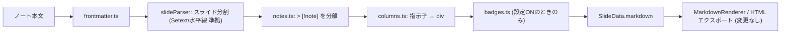

# 標準Markdown互換化 設計書 (Standard Markdown Compatibility Design)

> ステータス: **Approved**（2026-10-12 方針確定）
> 対象バージョン: 1.2.0

## 1. 背景と目的

これまでの Presenter は、スライド表現のために **CommonMark / GFM にない独自記法**（`::: cols-2` / `+++` / `:::`）を使っていました。
そのため、Obsidian と本プラグインを使っていない人がノートを受け取ると、記号がそのまま見えてしまい「崩れた文書」になります。

**目的**: ノートが **「どの標準Markdownビューアで開いても自然な文書として読める」** ことを保証したうえで、本プラグインでは同じファイルをプレゼン資料として表示できるようにする。

### 1.1 設計原則

| # | 原則 | 内容 |
| :- | :--- | :--- |
| P1 | **意味の一致** | 標準ビューアでの見た目と、プラグインのスライド解釈が同じ構造（見出し・段落・リスト）を指す |
| P2 | **不可視ヒント** | レイアウトなど「プレゼン専用の情報」は、標準ビューアで**表示されない**構文（HTMLコメント／フロントマター）にのみ書く |
| P3 | **優雅な劣化** | 不可視にできない装飾は、プラグインがなくても**意味が通じるテキスト**として残る記法に限る |
| P4 | **変換は表示時のみ** | プラグインはノート本文を書き換えない。変換はレンダリング直前のメモリ上でのみ行う |

### 1.2 互換性の判定基準（ターゲット環境）

- **GitHub**（GFM + Alerts）
- **CommonMark準拠ビューア**（VS Code プレビュー、Typora、markdown-it など）
- **Obsidian 標準のリーディングビュー**（プラグイン無効時）

### 1.3 確定した方針

| 論点 | 決定 |
| :--- | :--- |
| カラム指示子の表記 | 短縮形 `<!-- columns 2 plain -->` を基本とし、名前空間付き `<!-- presenter:columns -->` も別名として受け付ける |
| バッジ `[xxx]` | 維持する（既定 ON）。設定で OFF にできる |
| 旧 `:::` 記法 | **完全削除**（未リリースのため後方互換・変換コマンドは用意しない） |

---

## 2. 現状記法の互換性監査

| 記法 | 用途 | 標準ビューアでの表示 | 判定 | 対応方針 |
| :--- | :--- | :--- | :--- | :--- |
| `# H1` / `## H2` | 表紙・スライド区切り | 見出し | ✅ 互換 | 維持 |
| `---`（直前が空行） | 明示的改スライド | 水平線 | ✅ 互換 | 維持 |
| `段落\n---`（直前が段落行） | 明示的改スライド（旧実装） | **段落が H2 見出しになる（Setext見出し）** | ⚠️ 意味不一致 | **CommonMark 準拠の解釈に修正**（§5） |
| YAML フロントマター | テーマ上書き | GitHub は表、他は非表示 | ✅ 実質互換 | 維持 |
| `> [!note]` | 発表者ノート | GitHub: Alert / 他: 引用 | ✅ 互換 | 維持 |
| `::: cols-N [card\|plain]` … `+++` … `:::` | マルチカラム | **`:::` と `+++` が本文に見える** | ❌ 非互換 | **削除**し、HTMLコメント指示子に置き換える（§3） |
| `::: columns` / `::: column` | マルチカラム | **`:::` が本文に見える** | ❌ 非互換 | **削除**（§3 に統合） |
| `[重要] テキスト` | バッジ装飾 | `[重要] テキスト` という文字列 | 🟡 劣化するが意味は通る | 維持（P3 適合）。設定で無効化可能（§4） |
| `<div class="presenter-cols">` 直書き | マルチカラム | div 内が素の段落（GitHub は class を除去） | 🟡 | ドキュメントから削除（CSS があるので動作はする） |

> [!NOTE]
> 不可視にする手段として、Obsidian 固有の `%% コメント %%` は **採用しない**（Obsidian 以外では文字列として見えてしまい P2 に反する）。CommonMark で HTML ブロックとして定義され、ほぼすべてのビューアで非表示になる `<!-- -->` を採用する。

---

## 3. 新マルチカラム記法: HTMLコメント指示子 (Directives)

### 3.1 記法

```markdown
## 従来の課題と解決策

<!-- columns 2 card -->

### 従来の課題
- PowerPointの作成に時間がかかる
- バージョン管理が困難

### Presenterの解決策
- Markdown記述だけで自動スライド生成
- Gitでの完全なバージョン管理

<!-- /columns -->
```

- **標準ビューアでの表示**: コメントは非表示になり、「H3 + リスト」が縦に 2 つ並ぶ普通の文書になる。
- **Presenter での表示**: H3 ごとに 2 カラムのカードレイアウトになる。

### 3.2 文法

```text
開始:    <!-- columns [N] [card|plain] -->
区切り:  <!-- column -->            (任意)
終了:    <!-- /columns -->          (任意。省略時はスライド末尾まで)
```

- 指示子は **1 行に単独で** 書く（前後に空行を推奨。CommonMark 上も HTML ブロックとして確実に非表示になる）。
- 名前空間付きの別名 `<!-- presenter:columns ... -->` / `<!-- presenter:column -->` / `<!-- /presenter:columns -->` も受け付ける。
- トークンは大文字小文字を区別しない。順序は自由（`<!-- columns plain 3 -->` も可）。
- `N` は 1〜6。範囲外は無視して自動決定にする。

### 3.3 カラム分割ルール

開始から終了までの範囲（以下「カラム領域」）を、次の優先順位で分割する。

1. **明示区切り**: 領域内に `<!-- column -->` が 1 つ以上あれば、それで分割する。
   - 最初の `<!-- column -->` より前が空白だけなら、その空ブロックは捨てる。
2. **見出し分割（既定）**: 領域内で最初に現れる見出しのレベル（通常 H3）を基準にして、**同じレベルの見出しが現れるたびに新しいカラム**を始める。
   - 最初の見出しより前のテキストは、1 番目のカラムに含める。
3. **分割できない場合**: 見出しも区切りもなければ 1 カラムとして扱う（崩れずに表示される）。

カラム数の決め方:
- `N` 指定あり → グリッドの列数は `N`（分割数が `N` を超えると折り返す）。
- `N` 指定なし → 分割数（上限 6）。

スタイルの優先順位: **指示子 (`card`/`plain`) > フロントマター `columnStyle` > 設定 `defaultColumnStyle`**。

### 3.4 安全性ルール

- フェンスコードブロック（```` ``` ```` / `~~~`）内の指示子は無視する。
- カラム領域の外にある `<!-- column -->` / `<!-- /columns -->` は、何もせずにそのまま渡す（MarkdownRenderer 上も非表示）。
- 入れ子は非対応。領域内に 2 つ目の開始指示子が現れたら、前の領域を暗黙に閉じてから新しい領域を始める。
- 認識できないコメント（例: `<!-- TODO -->`）は加工せずにそのまま渡す。

### 3.5 出力（内部 HTML）

レンダラー・CSS・HTML エクスポーターを変えなくて済むよう、出力は **従来と同じ HTML 構造** にする。

```html
<div class="presenter-cols presenter-cols-2 presenter-cols-card">
<div class="presenter-col">

### 従来の課題
...

</div>
<div class="presenter-col">
...
</div>
</div>
```

### 3.6 拡張性

指示子パーサーは汎用（`<!-- name args... -->` → `{ name, args }`）として実装し、将来のスライド単位の指定（例: `<!-- slide center -->`）にも使えるようにする。本バージョンで実装するのは `columns` / `column` / `/columns` のみ。

---

## 4. バッジ記法 `[xxx]` の扱い

- 標準ビューアでは `[重要] テキスト` という文字列として表示され、**意味は失われない**（P3 適合）ため、記法は維持する。
- 「プラグイン独自の見た目変換を一切しない」運用をしたい人のために、設定 **Enable label badges**（既定: ON）を追加する。
- CommonMark では、同じ文書内に `[重要]: https://...` というリンク定義があると `[重要]` はリンクになる。これまでは定義行そのものだけを除外していたが、**定義が存在するラベル**も変換対象から外し、標準ビューアとの意味の食い違いをなくす（ラベルの照合は大文字小文字と連続空白を正規化して行う）。

---

## 5. スライド区切り `---` の CommonMark 準拠化

CommonMark では、**段落の直後の `---` は水平線ではなく Setext 見出し（H2）** になる。

```markdown
これは段落です
---
```

標準ビューアでは「これは段落です」が H2 見出しとして表示されるのに、旧パーサーは「段落 + 改スライド」と解釈しており、P1（意味の一致）に反していた。

**変更後の解釈**:

| 直前の行 | `---` の解釈 | スライド処理 |
| :--- | :--- | :--- |
| 空行 / スライド先頭 / ATX 見出し | 水平線 | **改スライド**（従来どおり） |
| 段落テキスト行 | Setext H2 見出し | 直前の段落行（複数行ならその段落全体）を**タイトルとする H2 スライド**として扱う |
| リスト項目・引用・表・HTML の行 | 水平線（CommonMark ではこれらの後の `---` は見出しにならない） | 改スライド |

- Setext H1（`タイトル\n===`）は表紙スライドとして認識する。
- `***` / `___` / `- - -` など、CommonMark の水平線のバリエーションも改スライドとして認識する。
- ATX 見出しの閉じ記号（`## タイトル ##`）は、タイトルから取り除く。

> [!NOTE]
> 「リスト項目の後の `---`」は、CommonMark では遅延継続行にならず水平線になる。ただしインデントされた継続段落などの細かいケースまでは追わず、「行頭が `-`/`*`/`+`/数字. /`>`/`|`/`<` で始まる行」は段落ではないと判定する簡易ルールにする。

---

## 6. 実装アーキテクチャ

`slideParser.ts`（428 行）を責務ごとに分割する（AGENTS.md の「200〜300 行を超えたら分割」規約に従う）。

```text
src/parser/
  slideParser.ts        # parsePresentation / getSlideIndexAtLine（全体の取りまとめのみ）
  frontmatter.ts        # extractFrontmatter
  fence.ts              # [新] フェンス状態を正しく追跡する共通ユーティリティ
  directives.ts         # [新] HTMLコメント指示子の検出・解析
  columns.ts            # [新] 指示子 → カラム div 変換（旧 ::: 変換は削除）
  badges.ts             # preprocessBadges（リンク定義の除外を追加）
  notes.ts              # extractSlideNotes
  blocks.ts             # [新] 水平線・Setext・段落行の判定
```



### 6.1 共通基盤: fence

これまでは 3 か所でフェンス判定を重複実装しており、「```` ``` ```` ブロック内の `~~~` でトグルしてしまう」「閉じフェンスの長さを見ない」という不具合があった。
CommonMark のフェンス規則（開始と同じ文字で、同じ長さ以上の行で閉じる）に従う `FenceTracker` を 1 つ用意し、すべての処理で共有する。

### 6.2 パース API の変更

```ts
export interface ParseOptions {
	defaultColumnStyle: ColumnStyle;
	enableBadges: boolean;
}
export function parsePresentation(raw: string, options?: Partial<ParseOptions>): PresentationData;
```

- 呼び出し側（`main.ts` の 2 か所、`presenterPreviewView.ts`）は設定から `ParseOptions` を組み立てて渡す。
- `presenterPreviewView.ts` が設定を渡さずに `parsePresentation(content)` を呼んでいたため、プレビューで `defaultColumnStyle` が反映されない不具合があった。これも合わせて直す。

### 6.3 設定の追加

| キー | UI 名 | 型 | 既定 |
| :--- | :--- | :--- | :--- |
| `enableBadges` | Enable label badges | boolean | `true` |

---

## 7. テスト計画

テストフレームワークは未導入のため、**依存を増やさず**既存の esbuild と Node 標準の `node:test` でパーサーの単体テストを実行する `npm test` を追加する（`scripts/run-tests.mjs` が `tests/*.test.ts` をバンドルして実行）。

主なテストケース:

- 指示子: 見出し分割 / 明示区切り / 終了省略 / `N` 指定 / スタイル指定 / コードブロック内は無視 / 未知のコメントは素通し / 名前空間付き別名 / 領域外の `<!-- column -->`
- 旧記法: `::: cols-2` が**変換されない**（テキストのまま）こと
- `---`: 空行の後 = 改スライド / 段落の直後 = Setext H2 スライド / リストの直後 = 改スライド / `===` = 表紙 / `***` = 改スライド
- バッジ: リンク定義があるラベルは変換しない、設定 OFF なら変換しない
- フェンス: ```` ``` ```` 内の `~~~`、4 連バッククォートの入れ子
- 行番号: `startLine` / `endLine` が Setext 見出しでも正しいこと

---

## 8. ドキュメント更新

- `README.md` / `specification.md` / `architecture.md` / `ui-ux.md`: カラム記法を新記法に書き換え、`:::` と HTML 直書きの記載は削除。
- `examples/sample-presentation.md`: 新記法に移行（ファイル自体が互換性のデモになる）。
- `CHANGELOG.md`: 1.2.0 として記載。`manifest.json` / `package.json` / `versions.json` のバージョンを更新。

---

## 9. 実装フェーズ

| フェーズ | 内容 |
| :--- | :--- |
| 1 | パーサー分割・`FenceTracker`・テスト基盤 |
| 2 | 指示子パーサーと新カラム記法、旧 `:::` の削除 |
| 3 | `---` / Setext の CommonMark 準拠化、バッジのリンク定義除外 |
| 4 | 設定 `enableBadges` 追加、プレビューで設定が反映されない不具合の修正 |
| 5 | ドキュメント・サンプル・CHANGELOG・バージョン更新、`npm run build` / `npm run lint` / `npm test` の通過確認 |
